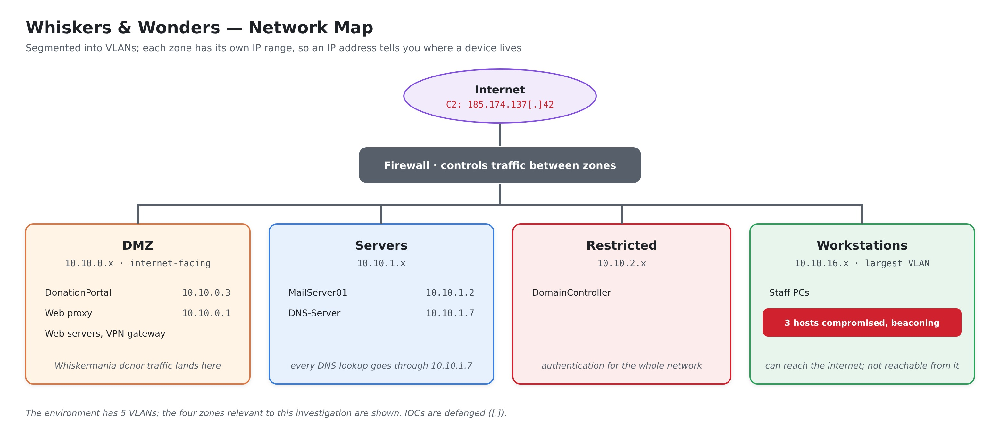
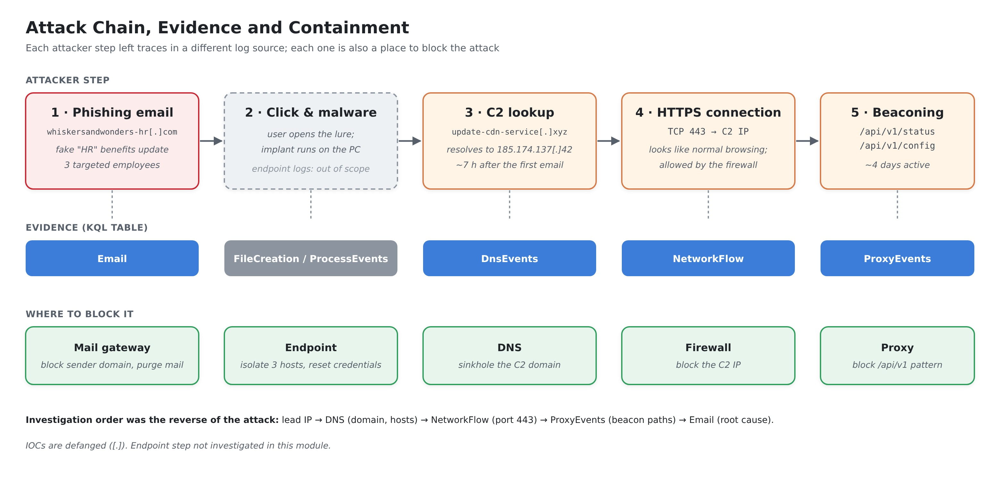

# SOC Investigation - Phishing to C2 Beaconing (KC7 "Whiskermania")

## Description

Network-focused SOC investigation of a simulated compromise at a fictional nonprofit, Whiskers & Wonders Cat Sanctuary, completed on the [KC7 Cyber](https://kc7cyber.com) platform. Starting from a single suspicious IP address, I used **KQL** to pivot across DNS, network-flow, proxy and email logs. I uncovered a phishing campaign that compromised three employees with access to the donation system, confirmed active **C2 beaconing** over HTTPS, scoped the impact, built a timeline and IOC list, and wrote containment actions and detection rules.

> **Platform:** KC7 Cyber, module *Whiskermania: An Intro to Network Concepts* (Advanced) · **Status:** completed, 81/81 questions, 2,275 points
> **Tools:** Azure Data Explorer (Kusto) · KQL · MITRE ATT&CK

---

## Executive Summary (Incident Report)

| Field | Finding |
|---|---|
| **Incident** | Credential phishing leading to malware and command-and-control (C2) beaconing |
| **Initial access** | Phishing email from the lookalike domain `whiskersandwonders-hr[.]com`, posing as HR ("Employee Benefits Update Required") |
| **Affected users** | 3 employees: a Development Officer and two Adoption Coordinators, all with access to donor or donation data |
| **C2 infrastructure** | `update-cdn-service[.]xyz` → `185.174.137[.]42`, TCP/443 (HTTPS) |
| **Beacon behaviour** | Periodic requests to `/api/v1/status` and `/api/v1/config` |
| **Time to compromise** | First C2 lookup about **7 hours** after the first phishing email |
| **Dwell time** | C2 active for about **4 days** at time of detection |
| **Business risk** | Attacker positioned on donation-system users five days before the organisation's largest fundraiser |
| **Recommended actions** | Block the C2 domain (DNS), IP (firewall) and URL pattern (proxy); isolate the 3 hosts; reset the affected credentials; block and purge the phishing sender |

---

## Overview

**Scenario:** I play the newly hired IT administrator at a cat sanctuary. The previous admin left suddenly, leaving notes about an external IP: *"185.174.137.42 - WHO IS THIS? Check again."* The sanctuary's biggest fundraiser, which brings in most of the year's donations, is five days away.

**Goal:** learn the network well enough to tell normal traffic from malicious traffic, then follow the lead to a full picture of the compromise.

**Approach:** the investigation runs in the **opposite order to the attack**. It starts at the last visible symptom (an external IP) and works back to the root cause (a phishing email):

```
lead IP → DNS (domain, affected hosts) → NetworkFlow (port) → ProxyEvents (beacon paths) → Email (root cause) → Employees (who)
```

## Data Sources

| Table | What it records | Used for |
|---|---|---|
| `DeviceInfo` | Asset inventory: name, IP, VLAN, host type | Mapping the network and identifying critical assets |
| `Employees` | Staff directory: name, username, role, IP | Turning compromised IPs into people and roles |
| `DnsEvents` | Every DNS lookup: client IP, domain queried, resolved IPs, TTL | Finding which hosts reached for the C2 domain, and when |
| `NetworkFlow` | Connections: source/destination IP and port, protocol, bytes | Confirming actual connections to the C2 IP |
| `ProxyEvents` | Web requests: full URL, method, status code (SSL inspection on) | Seeing the beacon paths inside HTTPS traffic |
| `Email` | Mail metadata: sender, recipient, subject, time | Finding the phishing campaign |

## Network Map



| Zone (VLAN) | IP range | Key assets |
|---|---|---|
| DMZ (internet-facing) | `10.10.0.x` | DonationPortal `10.10.0.3`, web proxy `10.10.0.1` |
| Servers | `10.10.1.x` | MailServer01 `10.10.1.2`, DNS-Server `10.10.1.7` |
| Restricted | `10.10.2.x` | DomainController |
| Workstations (largest) | `10.10.16.x` | Staff PCs, where the 3 compromised hosts are |

Because each zone has its own range, an IP address immediately tells you where a device sits. That's what makes `10.10.16.x → external IP` stand out.

---

## Investigation Walkthrough

All queries are in [`/queries`](queries), one file per phase.

### Phase 1: Understand the environment

*Before hunting, know what you're defending.*

```kql
DeviceInfo
| summarize device_count = count() by vlan
| order by device_count desc
```

The network is split into **5 VLANs**, and workstations are the largest. I listed the assets in each zone and noted the crown jewels: the **DonationPortal** in the DMZ, which the fundraiser depends on, and the **DomainController** in the restricted zone.

**Analyst reasoning:** a baseline makes later anomalies obvious. A workstation talking to the internal DNS server is normal. A workstation talking repeatedly to an unknown external host is not.

→ [`01-environment-baseline.kql`](queries/01-environment-baseline.kql)

### Phase 2: Establish normal traffic

```kql
NetworkFlow
| summarize traffic = count() by dest_port
| order by traffic desc
| take 5
```

- **Port 25 (SMTP)** carries the most traffic. That's expected for an organisation that emails donors, adopters and volunteers.
- **TCP** carries most traffic overall. **DNS runs over UDP/53.**

I then traced **one legitimate request** (a workstation opening `docs.google.com`) through every log source. One user action leaves a trail in three tables:

| Step | Table | Evidence |
|---|---|---|
| 1 | `DnsEvents` | Domain resolved to an IP |
| 2 | `NetworkFlow` | UDP/53 to the internal DNS server `10.10.1.7` |
| 3 | `NetworkFlow` | TCP/443 to the resolved IP |
| 4 | `ProxyEvents` | Full URL, HTTP 200 |

**Analyst reasoning:** if I know what a normal request looks like across all three sources, I can apply the same pivot to a malicious one. DNS always comes first, so it's a record of *intent*. It shows what a host tried to reach, even when the connection itself is encrypted.

→ [`02-traffic-baseline.kql`](queries/02-traffic-baseline.kql) · [`03-trace-one-request.kql`](queries/03-trace-one-request.kql)

### Phase 3: Pivot from the lead

The previous admin's note pointed at `185.174.137[.]42`, a **public** IP. Which domain resolves to it, and who asked?

```kql
DnsEvents
| where resolved_ips has "185.174.137.42"
| distinct query_name
```

**Finding:** the IP belongs to `update-cdn-service[.]xyz`. It's an **external** domain that **3 internal workstations** have been looking up.

**Analyst reasoning:** the name is built to look like boring infrastructure ("update", "cdn", "service"), and `.xyz` is a cheap top-level domain that attackers favour. Real CDNs don't look like this. Three workstations querying it suggests a campaign, not a one-off.

→ [`04-pivot-from-suspicious-ip.kql`](queries/04-pivot-from-suspicious-ip.kql)

### Phase 4: Confirm command and control

```kql
ProxyEvents
| where domain == "update-cdn-service.xyz"
| project timestamp, src_ip, url, method, status_code
| order by timestamp asc
```

**Findings:**
- `NetworkFlow` shows connections to the C2 IP on **TCP/443**. To the firewall this is ordinary outbound HTTPS, which is exactly why attackers use it.
- `ProxyEvents` (with SSL inspection on) shows **6 requests** to two repeating paths, `/api/v1/status` and `/api/v1/config`.

**Analyst reasoning:** these look like API calls, but this is **C2 beaconing**. The implant checks in ("I'm still here, any instructions?") and pulls its configuration. Human browsing is random. Beacons are regular and repeat the same paths, and that regularity is what gives them away.

→ [`05-confirm-c2.kql`](queries/05-confirm-c2.kql)

### Phase 5: Find the root cause

Most compromises start with phishing, so I looked for senders who use the organisation's name **without** its real domain:

```kql
Email
| where sender !endswith "@whiskersandwonders.org"
| where sender contains "whiskersandwonders"
| project timestamp, sender, recipient, subject
```

**Findings:**
- Lookalike sender domain: `whiskersandwonders-hr[.]com`. It's not the real `whiskersandwonders.org`.
- Subject: *"[EXTERNAL] Important: Employee Benefits Update Required"*, which uses authority (HR) and urgency, classic social engineering.
- **3 recipients**, and correlating them with the DNS evidence shows **all three phishing recipients are the three beaconing hosts**.

**Analyst reasoning:** the correlation turns two separate observations ("odd emails" and "odd DNS lookups") into one confirmed attack chain. Notably, the mail gateway even tagged the message `[EXTERNAL]`, but that wasn't enough to stop the clicks.

→ [`06-root-cause-phishing.kql`](queries/06-root-cause-phishing.kql)

### Phase 6: Scope, impact and timeline

```kql
DnsEvents
| where query_name contains "update-cdn-service.xyz"
| distinct client_ip
| join kind=inner (Employees | project ip_addr, name, username, role) on $left.client_ip == $right.ip_addr
| project name, username, role
```

**Findings:**
- **Compromised users:** one **Development Officer**, who manages donor relationships, and two **Adoption Coordinators**, who handle donor and adopter data.
- **This was targeted, not random.** All three have access to the donation system, and the fundraiser is five days away.
- **Time to compromise:** about 7 hours from the first email to the first C2 lookup.
- **Dwell time:** C2 had been active for about 4 days.

→ [`07-scope-and-timeline.kql`](queries/07-scope-and-timeline.kql)

### Phase 7: Response and detection



**Containment and eradication**

| Priority | Action | Control point |
|---|---|---|
| 1 | Isolate the 3 compromised workstations | Endpoint / network |
| 2 | Block `update-cdn-service[.]xyz` | DNS (sinkhole) |
| 3 | Block `185.174.137[.]42` | Firewall |
| 4 | Block the `/api/v1/(status\|config)` pattern | Proxy |
| 5 | Reset credentials for the 3 affected users | Identity (Active Directory) |
| 6 | Block `whiskersandwonders-hr[.]com` and purge the email from all mailboxes | Mail gateway |

**Further steps I would take in a real environment:**
- Review the **DonationPortal** logs for access by the three accounts during the dwell time, to see whether the attacker reached donation data.
- Hunt for **other hosts** beaconing to the same `/api/v1/*` pattern on other domains, in case the attacker rotated infrastructure.
- Investigate the endpoints to find the malware and how it persists. This module covered only network evidence.
- Notify management and decide on external reporting. Donor data may be involved, which can trigger GDPR breach-notification duties in the EU.
- Run targeted phishing awareness for staff before the fundraiser.

**Detection rules**

```kql
// 1. DNS lookup of the known C2 domain
DnsEvents
| where query_name in ("update-cdn-service.xyz")

// 2. Any connection to the C2 IP
NetworkFlow
| where dest_ip == "185.174.137.42"

// 3. Behaviour-based: beacon-style API paths on .xyz domains
ProxyEvents
| where url matches regex @"/api/v\d+/(status|config)"
| where domain endswith ".xyz"
```

Rules 1 and 2 catch **this** attacker. Rule 3 is the more valuable one, because it catches the **behaviour** even if the attacker changes domain and IP.

→ [`08-detection-rules.kql`](queries/08-detection-rules.kql)

---

## Timeline

| Time (as logged) | Event | Source |
|---|---|---|
| 2025-06-02 16:00 | First phishing email from `whiskersandwonders-hr[.]com` reaches 3 employees | `Email` |
| about 7 hours later | First DNS lookup of `update-cdn-service[.]xyz` from a phishing recipient's workstation | `DnsEvents` |
| Following days | Periodic HTTPS beacons to `/api/v1/status` and `/api/v1/config` | `NetworkFlow`, `ProxyEvents` |
| About 4 days after the first beacon | Activity detected and scoped; containment recommended | Investigation |

## Indicators of Compromise

| Type | Indicator | Context |
|---|---|---|
| Domain | `update-cdn-service[.]xyz` | C2 server |
| IPv4 | `185.174.137[.]42` | C2 server, TCP/443 |
| Domain | `whiskersandwonders-hr[.]com` | Phishing sender (lookalike of the real domain) |
| URL path | `/api/v1/status` | Beacon check-in |
| URL path | `/api/v1/config` | Beacon configuration pull |
| Email subject | `[EXTERNAL] Important: Employee Benefits Update Required` | Phishing lure |

*Indicators are defanged (`[.]`) so they can't be clicked. They come from a fictional training scenario.*

## MITRE ATT&CK Mapping

| Tactic | Technique | Evidence |
|---|---|---|
| Resource Development | T1583.001 Acquire Infrastructure: Domains | Lookalike HR domain and a C2 domain made to look like CDN infrastructure |
| Initial Access | T1566 Phishing | Fake HR email to three targeted staff |
| Execution | T1204 User Execution | Recipients interacted with the lure before the C2 lookups started |
| Command and Control | T1071.001 Application Layer Protocol: Web Protocols | Beaconing over HTTPS (TCP/443) to `/api/v1/*` |

## Lessons Learned

- **DNS is the analyst's best friend.** Every connection starts with a lookup, so DNS logs show what a host *tried* to reach, even when the traffic itself is encrypted.
- **No single log tells the story.** DNS gave the hosts, NetworkFlow the port, the proxy the beacon paths, Email the root cause, and the employee directory the people. Correlating across tables is the core analyst skill.
- **What controls miss:** the firewall allowed the C2 traffic because outbound 443 looks like normal browsing. Without SSL inspection on the proxy, the beacon paths would have been invisible.
- **Targeting reveals intent.** Asking *who* was hit (people with donation-system access, just before the fundraiser) turned a technical finding into a business risk management could act on.
- **Block in layers, detect on behaviour.** Blocking indicators stops this attacker today. A behaviour-based rule, like the beacon-path regex, keeps working after they change domain and IP.

## Skills Demonstrated

- KQL threat hunting: `where`, `summarize`, `distinct`, `join`, `between`, `matches regex`, time aggregation
- Pivoting and correlating across DNS, network flow, proxy, email and identity data
- Network fundamentals for analysis: IP addressing, public vs private ranges, VLAN segmentation, ports, TCP/UDP, DNS records, HTTP methods and status codes
- Phishing analysis: lookalike domains and social-engineering indicators
- C2 beaconing detection
- Incident scoping, timeline building and IOC extraction
- Containment planning and detection engineering
- MITRE ATT&CK mapping and incident reporting

A KQL quick reference built during this investigation is in [`docs/kql-cheatsheet.md`](docs/kql-cheatsheet.md).

---

*Scenario, data and story by [KC7 Cyber](https://kc7cyber.com); module authors Simeon Kakpovi, Kell Duda and Jibby Saetang. Write-up and analysis by Mazen Yousef.*

*Author: Mazen Yousef | [LinkedIn](https://linkedin.com/in/mazenyousef) | [TryHackMe](https://tryhackme.com/p/mazen.yousef)*
